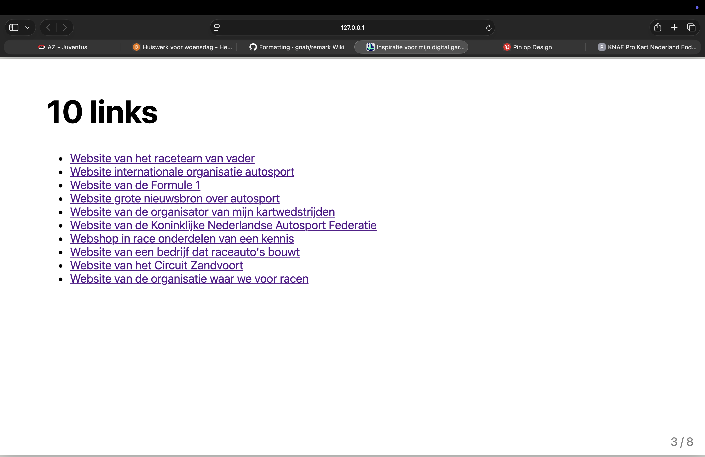
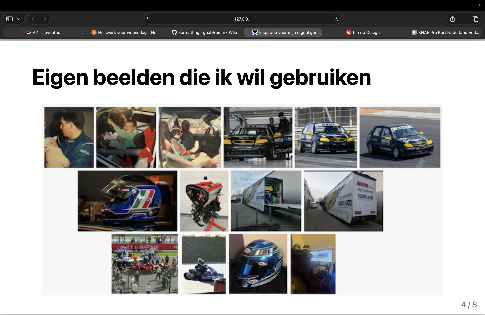
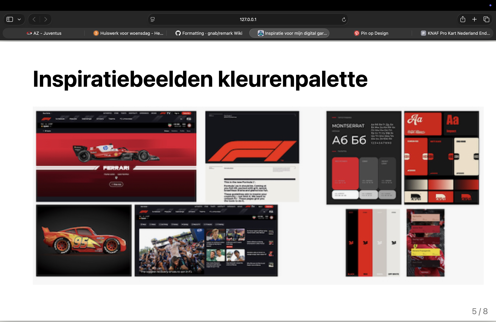
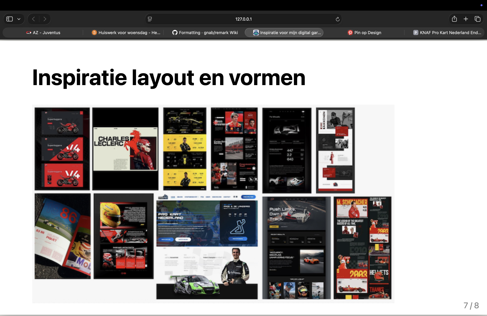
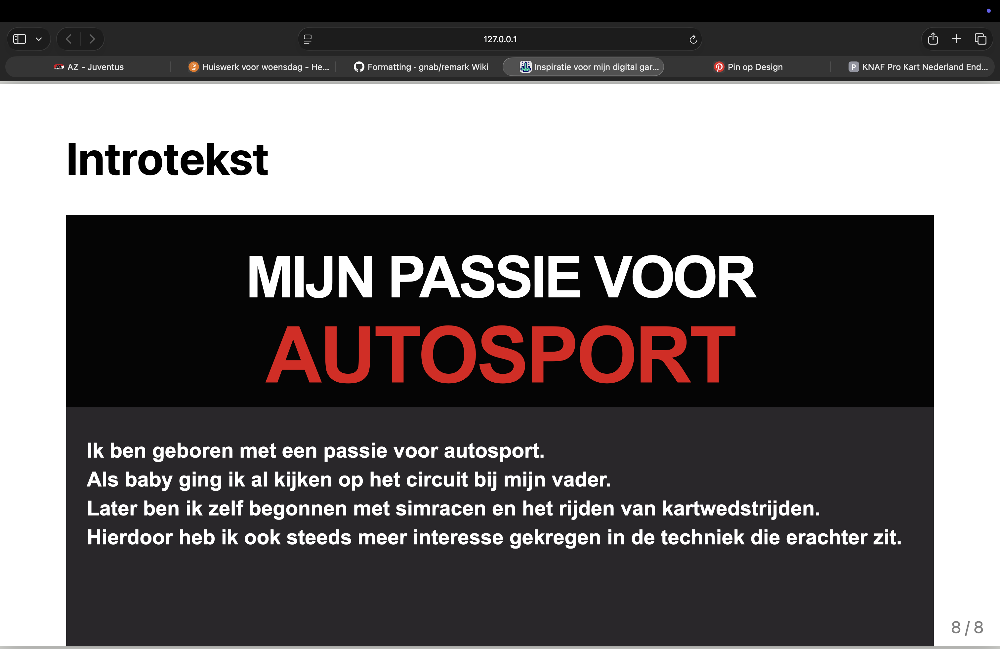
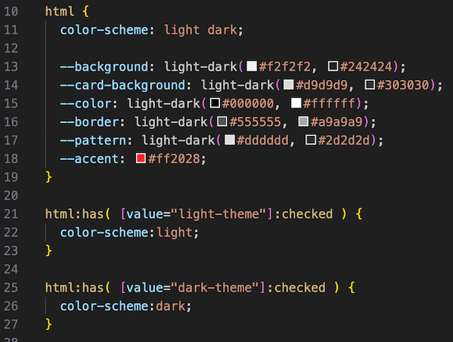

# Model

Het staat model voor digitale tuintjes welke bij 'Het web is voor iedereen' door studenten worden gemaakt.

## Learning Log

### 9 okt - Sprint 3 - Vr: Werkgroep 15

### 7 okt - Sprint 3 - Wo: Werkgroep 14

1. Een grid kan houvast geven bij het plaatsen en uitlijnen van elementen. Zo ontstaat er een consistente en overzichtelijke vormgeving.

2. Het gebruiken van een grid, werken met hiërarchie en het gebruiken van consistente spacing.

3. Ik vind dat dit kan zolang het de gebruiksvriendelijkheid van de pagina niet in de weg zit. Daarom vind ik het in mijn website leuk om de basis simpel te houden en op sommige plekken leuke icoontjes toe te passen. Ook omdat ik het verder niet bij het onderwerp en thema van mijn pagina vind passen.

### 5 okt - Sprint 3 - Ma: Werkgroep 13

1. Betekenis van de termen;
   Kerning; de ruimte tussen twee specifieke tekens aanpassen
   Tracking; letterspatiëring van een tekst aanpassen
   Leading; de verticale afstand tussen de basislijnen
   Flush-left; tekst links uitlijnen
   Flush-right; tekst rechts uitlijnen
   Centered; ekst centraal uitlijnen
   Justified; tekst links en rechts uitgelijnd
   Indent; eerste regel springt in naar rechts
   Outdent; eerste regel springt in naar links
   Modular scale; lettergrootte aanpassen aan de hand van een vaste verhouding
   Movable type; losse, verplaatsbare letters of tekens
   Focus point; het belangrijkste aandachtspunt van een ontwerp
   Vijf soorten contrast; grootte, kleur, vorm, gewicht, ruimte
   Spatial tension; spanning door het spelen met witruimtes tussen elementen

2. Dit ligt rond de 50 tekens per regel. Ik vind dit namelijk prettig lezen, omdat ik mijn ogen niet te veel over het scherm hoef te bewegen. Lange regels hebben meestal een hogere drempel om te blijven lezen. Bij kortere regels wordt het snel onrustig doordat je vaak naar een nieuwe regel moet.

3. Dan zou ik kiezen voor grootte, omdat je snel duidelijk kunt maken welke informatie het belangrijkste is. Het is ook een eenvoudige manier om hiërarchie aan te brengen zonder verschillende lettertypes of ingewikkelde vormen te gebruiken.

### 2 okt - Sprint 2 - Vr: Werkgroep 12

Feedback van Sanne;
Door afwezigheid ivm ziekte heb ik de afgelopen dagen weinig kunnen doen.
Ik heb wel een mooi lijstje opgesteld van de feedback en wat ik hiermee wil doen;

### 30 sept - Sprint 2 - Wo: Werkgroep 11

### 28 sept - Sprint 2 - Ma: Werkgroep 10

1. Met deze uitspraak bedoelt Vasilis dat hij zich liever richt op hoe prettig en gebruiksvriendelijk HTML-elementen te gebruiken zijn, dan alleen op de betekenis en de structuur van de HTML-code. Zo is de website goed te bedienen en te begrijpen voor bijvoorbeeld gebruik met een toetsenbord of screenreader.

2. De meest voorkomende zijn slechtziend, of blind, zijn en slechthorend, of doof, zijn.

3. In mijn website kan je op de volgende manieren navigeren met een screenreader;
   Headings. Met de screenreader kan je van jaartal naar jaartal springen om snel door de inhoud van de pagina te navigeren.
   Landmarks. Mijn website bevat onder andere header, nav, main en footer. Met een screenreader kan ik rechtstreeks naar de navigatie, hoofdinhoud of de voettekst gaan.
   Formulierelementen. De light/dark mode is te bedienen met de screenreader.

### 25 sept - Sprint 2 - Vr: Werkgroep 9

1.

### 23 sept - Sprint 2 - Wo: Werkgroep 8

1. Een wireframe is een schematische weergave van een website. Hierin zie je waar verschillende elementen komen te staan. Als ontwerper kun je hiermee de structuur van een website bepalen voordat je begint met het coderen ervan.

2. Dark UX patterns zijn ontwerptechnieken die gebruikers bewust in een bepaalde richting sturen, vaak in het voordeel van degene die achter de website zit en in het nadeel van de gebruiker.
   Drie voorbeelden zijn;
   'Hard to cancel'; een abonnement afsluiten is eenvoudig, maar het opzeggen ervan is onnodig moeilijk gemaakt.
   'Hidden costs'; extra kosten worden pas duidelijk aan het einde van het bestelproces.
   'Misleading choises'; een knop om cookies te accepteren is opvallend, terwijl de optie om cookies te weigeren moeilijk te vinden is.

3. Bij het maken van een human consent component zorg je er als ontwerper voor dat de gebruiker een vrije keuze kunnen maken waar zij goed over geïnformeerd zijn. Het moet even makkelijk zijn om te accepteren als te weigeren en de gebruiker moet dit later ook eventueel kunnen wijzigen.

### 21 sept - Sprint 2 - Ma: Werkgroep 7

1. HTML landmark elementen geven de structuur en de belangrijke onderdelen van een website aan. Deze elementen zorgen ervoor dat browsers maar ook screenreaders de structuur van de pagina begrijpen en kunnen bezoekers makkelijk navigeren. Voorbeelden hiervan zijn onder andere een header, nav, main en een footer.

2. Heading elementen zijn koppen waarmee je de inhoud van een website structureert. Dit gaat van h1 voor de hoofdtitel van de pagina tot h6, het laagste headingniveau. Je hoort de headings te nesten op basis van de inhoudelijke hiërarchie, niet alleen op basis van hoe groot de tekst eruit moet zien.

3. Ik ging zelf, als je kijkt naar hoe het ons geleerd wordt op deze opleiding, bijzonder slecht met cookies om. Bij elke website waar ik de keuze krijg koos ik voorheen eigenlijk altijd voor accepteer alles. Dit kwam vooral omdat ik totaal geen beeld had bij wat het precies betekende en het op dat moment vooral voelde als de makkelijke keuze. Sinds we uitleg hebben gekregen hierover let ik steeds meer op de melding en kies ik als dit kan voor het weigeren van de cookies.

### 18 sept - Sprint 1 - Vr: Voortgangsgesprek

Vandaag kreeg ik feedback van Sanne. Het grootste kritiekpunt was dat mijn ReadMe nog niet ver genoeg ingevuld was. Hier kan ik de komende weken dus mee aan de slag. Verder had ik in mijn code gebruikt gemaakt van classes wat niet mocht. Dit heb ik vandaag meteen aangepast. Ook had Sanne het idee dat ik mijn website nog wat spannender kan maken door bijvoorbeeld een animatie toe te passen.

Check-out:

Oriënteren&Begrijpen
Ik denk dat de docenten ons deze opdracht hebben gegeven om ons kundiger te maken in het gebruiken van HTML en CSS en alles wat daarbij komt kijken.
Ik gebruik zelf VisualStudioCode voor het maken van de code voor mijn project. Tijdens het eerste deel van dit blok heb ik geleerd dat er veel meer gedaan kan worden met code dan ik dacht. Deze kennis probeer ik zoveel mogelijk toe te passen.

Verbeelden&Conceptualiseren
Toen ik eenmaal wist waar ik mijn project over wilde gaan maken heb ik veel nagedacht hoe ik dit wilde gaan vormgeven. Vervolgens heb ik door onder andere het schetsen van een crazy8 bepaald hoe ik dit vorm wilde gaan geven en ben ik uiteindelijk uitgekomen op een tijdlijn. Vervolgens heb ik meerdere versies geschetst van hoe deze tijdlijn er uit moest komen te zien. Vervolgens heb ik de versie die mij het meeste aanspreekt uitgewerkt tot een digitale versie.
Voor mijn website gebruik ik tekst en afbeeldingen die mijn interesse in autosport laten zien. Een belangrijk element in mijn website zijn deze afbeeldingen aangezien die een belangrijk deel van het verhaal verduidelijken. Verder zijn de tijdblokken in de tijdlijn belangrijk aangezien die zorgen voor de structuur in de pagina.
Dit alles wil ik vormgeven in een stijl die past bij het onderwerp. Dit probeer ik te doen door een passend lettertype te kiezen en een kleurenpallet te gebruiken die goed aansluit op het onderwerp. Ik heb gekozen voor het lettertype Racing Sans One en donkere achtergrondkleuren die gecontrasteerd worden door rode accenten. Ik gebruik verschillende lettergroottes om de inhoud interessant een aantrekkelijk te maken voor de persoon die de website bezoekt. Om de pagina niet chaotisch te maken heb ik er wel voor gekozen om het ontwerp subtiel te houden zodat dit, met de aanwezigheid van stukken tekst, de bezoeker al snel kan afschrikken.

Prototypen&Uitwerken
Ik heb geprobeerd mijn website overzichtelijk te maken en de inhoud op een logische manier te presenteren. Dit heb ik gedaan door de informatie die op de website staat in een chronologische volgorde van boven naar beneden te plaatsen. Alle personen aan wie ik de website heb laten zien, snapten wat de bedoeling was van de website en vonden de website logisch opgebouwd.
Tijdens het feedbackgesprek met Sanne bleek dat het design zelf goed en logisch is. Volgens hem kon ik het echter nog iets interessanter maken door er bijvoorbeeld een animatie aan toe te voegen.

Evalueren
Ik wilde in het begin van dit blok leren hoe ik een eigen bedacht design van een website kon omzetten naar een werkelijke website. Dit hebben we vorig jaar ook al deels gedaan, maar niet tot zo ver uitgewerkt.
Door verschillende technieken van HTML en CSS te leren en toe te passen ben ik uiteindelijk tot een mooie eerste versie van mijn website gekomen waardoor de basis alvast staat. Ik heb hierin mijn verhaal over mijn passie goed kunnen vertellen en ook nog een kunnen vormgeven zoals ik zelf voor ogen had. Ik heb hierbij in korte tijd al meer kennis opgedaan over het schrijven van code als in heel vorig jaar. In het vervolg wil ik nog meer leren over hoe ik een animatie kan gaan toevoegen.
Ik vind het leuk om zelf ideeën te bedenken en deze visueel uit te werken. Voorheen deed ik dit altijd in een programma als Canva, maar ik heb geleerd dit al snel in HTML en CSS uit te werken. Dit vond ik minder leuk aangezien dit proces bij mij, vooral aan het begin, best moeizaam verliep en ik er een stuk langer over deed dan wanneer ik dit in Canva zou doen.
Tijdens de feedback op mijn code werd ik alleen aangesproken op het gebruiken van classes, maar dit heb ik op dezelfde dag zelfs nog kunnen aanpassen.
Tijdens de toegankelijkheidscheck was mijn website volledig te bedienen met het toetsenbord van mijn laptop. Dit was ook niet lastig aangezien de enige functies het bedienen van de light/dark mode zijn en het scrollen tussen de verschillende blokken van de tijdlijn.
Mijn website is ook nog adaptief doordat deze een zelfde layout aanhoudt op verschillende schermformaten. Ook is de website dus in zowel een light als een dark mode te gebruiken.
Mijn afbeeldingen die ik gebruik komen van eigen foto's en dus niet van externe websites. Ook het lettertype wat ik gebruik staat locaal op mijn laptop gedownload en linkt dus niet naar een externe website. Zo voldoe ik volledig aan de wet.
Doordat ik over een eigen interesse vertel aan de hand van veel eigen beelden en echt een eigen verhaal vertel wat ook nog eens vorm is gegeven op een manier die mij aanspreekt, vind ik dat ik mijzelf zeker terugzie in mijn website.

### 16 sept - Sprint 1 - Wo: WS5

1. Drie voorbeelden van Gestallt- of designprincipes zijn 'Nabijheid' waarmee benadrukt wordt dat elementen die dicht bij elkaar staan bij elkaar horen. 'Gelijkenis' waarbij benadrukt wordt dat elementen met dezelfde kleur, vorm of grootte gezien worden als een geheel en 'Figuur en achtergrond' waarbij het vooral belangrijk is dat er onderscheidt ontstaat tussen een belangrijk element en de achtergrond daarvan, waardoor het beter opvalt.

2. Een grid geeft je vrijheid aangezien je op deze manier gemakkelijk elementen op verschillende manieren kunt plaatsen. Tegelijkertijd zorgt het voor eenheid en structuur doordat je een vaste basis hebt waar je op terug kunt vallen als je verschillende elementen aan het plaatsen bent.

3. Voor mijn eigen website richt ik me vooral op 'Contrast & Dynamiek' door grote teksten, rode accenten en opvallende afbeeldingen toe te passen en deze te koppelen aan een duidelijke structuur. Ik vind dit zelf namelijk passen bij de energie die autosport uitstraalt.

### 14 sept - Sprint 1 - Ma: WS4 + Bi-weekly geek 1
Bi-weekly geek 1

Check-out
1. Een website kan snel lelijk worden doordat deze niet 'responsive' is. Hiermee wordt bedoeld dat een website niet voorbereid is op verschillende schermgroottes. Als je de website dan opent op een kleiner formaat zoals een telefoon, verspringen er meestal allerlei teksten en afbeeldingen. Dit kan door een simpele regel in code, die we gekregen hebben van Vasilis en bij de tweede vraag benoemd staat, wel responsive gemaakt worden.

2. Van Vasilis hebben we een voorbeeldregel gekregen om onze website responsive te maken. Deze heb ik vervolgens aangepast naar de code voor mijn eigen website. Hiermee geef je aan dat als een schermbreedte kleiner wordt dan een aangegeven waarde, dat er een andere vormgeving wordt toegepast.;

3. Mijn Garden gebruikt een constante stijl (vormen en lettertype) en een overzichtelijke layout. Ook heb ik de website responsive gemaakt voor meerdere schermen.

### 12 sept - Sprint 1 - Vr: WS3 + Voortgang

Ik heb van Justus vandaag feedback gekregen op mijn idee voor mijn website.
Het idee wat ik voor mijn website heb heeft volgens Justus zeker potentie, ik moet alleen mijn ontwerp wat ik in mijn hoofd had nog gaan uitwerken in HTML/CSS en hier gewoon dingen mee gaan proberen. Ook ben ik geholpen met het terugkrijgen van mijn README bestand wat op bijzondere wijze verdwenen was. Gelukkig had ik dit ook in mijn notities bijgehouden waardoor ik het snel weer terug kan bijwerken.

### 10 sept - Sprint 1 - Wo: WS2

1. Je begint met het onderzoek en verzamelen van inspiratie. Hiervan bepaal je welke inspiratie je het meest aanspreekt en wat relevant is. Aan de hand hiervan kom je op een duidelijk idee voor je eigen ontwerp.

2. Mijn garden gaat over mijn passie voor autosport. Aan de hand van eigen afbeeldingen wil ik mijn verhaal vertellen.

3. Om tot een idee te komen hoe ik mijn tuintje wil opbouwen heb ik een crazy8 opgesteld. Van deze ideeën sprak mij het concept van een tijdlijn het meest aan. Aan de hand van deze tijdlijn, die ik ga opbouwen uit eigen beelden, wil ik overbrengen hoe ik een passie voor autosport heb ontwikkeld.

Hier wilde ik een afbeelding toevoegen van mijn crazy8, maar deze heb ik helaas nergens meer kunnen vinden. Wel heb ik nog afbeeldingen van mijn conceptvoorstel.

### 8 sept - Deepdive Light&Dark theme

Na het volgen van de deep-dive over de light en dark mode heb ik alvast een code kunnen schrijven voor de kleuren die ik voor mijn eigen website wilde gaan gebruiken.

### 7 sept - Sprint 1 - Ma: Sprintplanning + WS1

1. Een digital garden is een persoonlijke website waar je informatie kan delen over een onderwerp wat jou persoonlijk aanspreekt. Zo'n digital garden is nooit af en kan regelmatig aangevuld/verbeterd worden. Een digital garden is een stuk persoonlijker dan een website en de schrijver ervan heeft geen autoriteit en kan dus fouten maken en eventueel van mening veranderen.

2. Een website wordt webby wanneer deze creatief, interactief, volwassen, gebruiksvriendelijk en visueel aantrekkelijk is.

3. In mijn digital garden wil ik mensen mijn passie voor autosport overbrengen. Hoe ik dit wil gaan doen weet ik nog niet precies

### 3 sept - Workshop deep-dive van Justus

Tijdens deze deep-dive HTML & CSS Basics heb ik vooral geleerd hoe het inladen van een website nou eigenlijk gebeurt. Als je een website opent, wordt er een HTTP-request naar de server gestuurd om de benodigde bestanden op te vragen. Vervolgens stuurt de server deze bestanden terug, zodat de website in de browser kan worden weergegeven. Het verbaasde mij dat er meerdere requests nodig zijn om een website volledig te laden aangezien dit voor de gebruiker met een klik gedaan is.

### 31 aug - Kickoff

1. Als source hosting platform heb ik gekozen voor GitHub. Dit is een online server waar je de code voor je website kan opslaan, beheren en delen met anderen.

2. Ik heb gekozen voor massimobenedetti.nl en deze heb ik gekoppeld door de stappen te volgen die we op DLO gekregen hebben.

3. Ik kan aanpassingen aan mijn webpagina maken door aanpassingen te maken in mijn HTML en CSS bestanden die gelinkt zijn aan mijn GitHub en deze vervolgens te committen.
